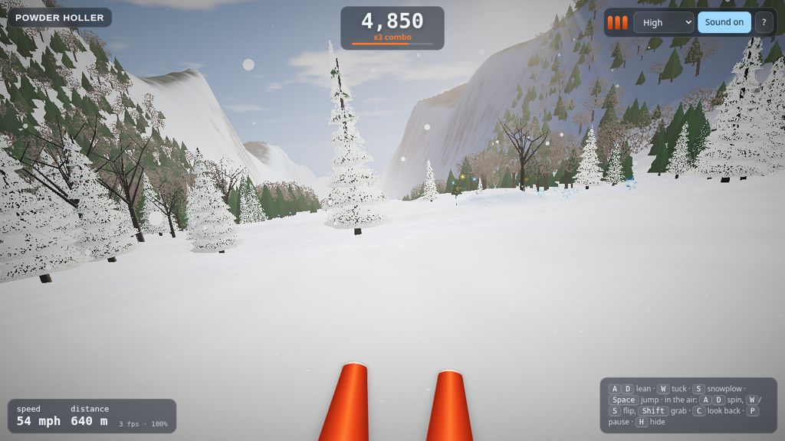
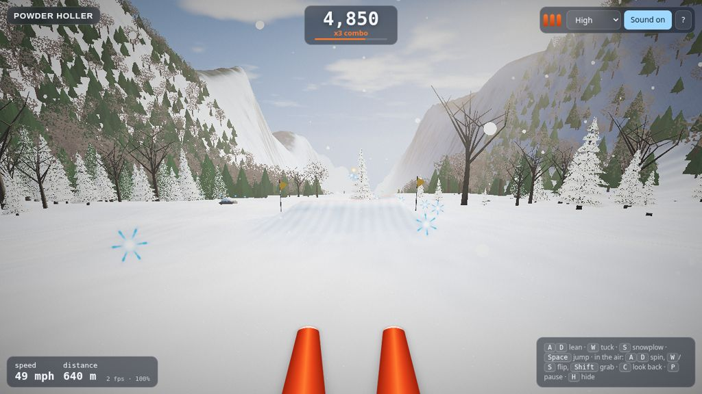
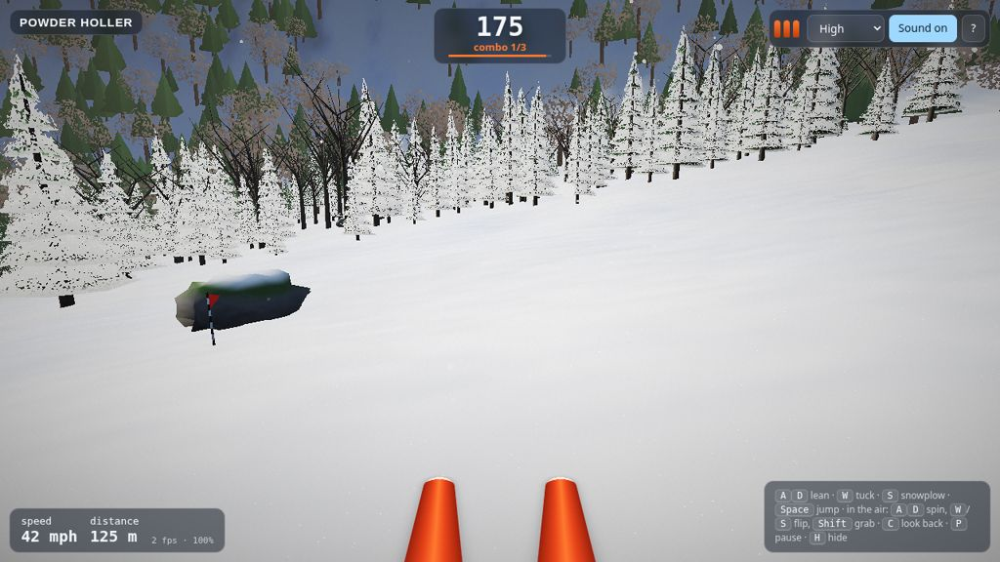
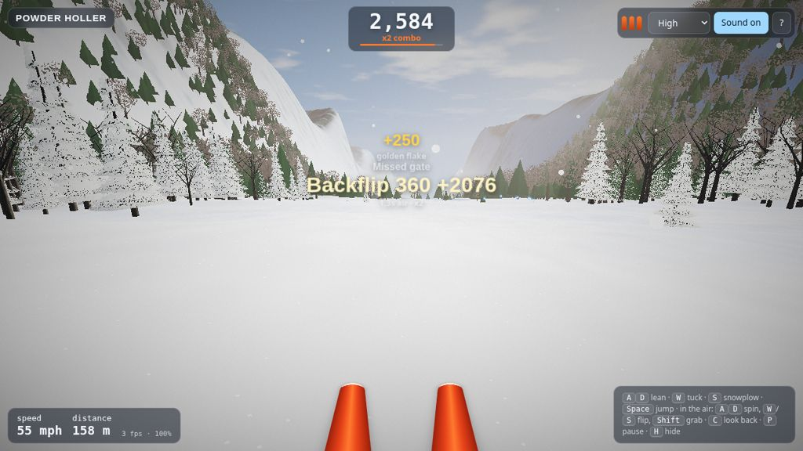
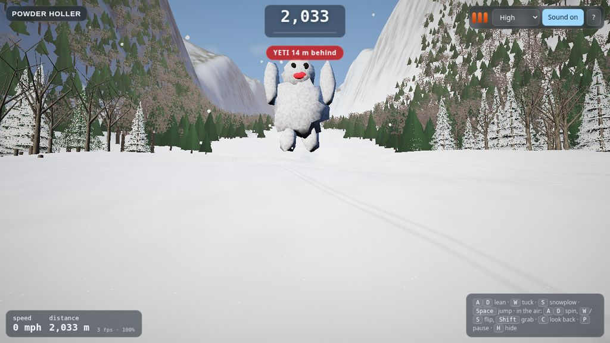

# Powder Holler

An endless, procedurally generated, first-person ski run down the Appalachian high country, in your browser.
Lean through red spruce and Fraser fir, hit kickers, spin and flip, snag glowing snowflakes, thread slalom gates,
and keep ahead of the Holler Yeti, who wakes up once you pass 2,000 m.

**▶ Play: https://timothyrmccaslin-sys.github.io/PowderHoller/**

| Kicker ahead | 360 in the air | Trick landed | Look back... |
|---|---|---|---|
|  |  |  |  |

Raw WebGL2 and plain ES modules. No engine, no libraries, no build step, and no image, model or audio files.
The mountain, trees, yeti and sounds are all generated in code, in about 98 KB of source.

## Controls

| Keyboard | Touch | Action |
|---|---|---|
| `A` `D` / `←` `→` | hold left / right edge (or tilt the phone) | lean and carve left / right |
| `W` / `↑` | hold the middle | tuck for speed (and push off when slow) |
| `S` / `↓` | drag down in the middle | snowplow to brake |
| `Space` | tap the middle or swipe up | jump |
| in the air: `A` `D` | left / right edge | spin |
| in the air: `W` / `S` | hold the middle | front flip / backflip |
| in the air: `Shift` (or `F`) |  | grab |
| `C` |  | look back over your shoulder |
| `P` / `Esc` |  | pause |
| `R` / `Enter`, `N` |  | after a game over: ride again, or try a new mountain |
| `Q`, `M`, `H` |  | quality, sound, hide help |

Turn your skis sideways to the slope to stop, like the original. Let go of the spin and flip keys in the air
and you rotate back to the nearest clean landing.

URL options: `?seed=42` for a different mountain, `?q=low|medium|high`.

## Scoring

- **Distance:** 1 point per metre down the mountain.
- **Snowflakes:** 50 each. Golden flakes are worth 250. Kickers have a line of flakes floating over the landing.
- **Slalom gates:** 150 for skiing between the flags.
- **Tricks**, scored when you land cleanly: 360s (300, more for 720s and up), flips (600 each), grabs, and big air time.
- **Combo:** every flake, gate or trick within 5 seconds of the last one builds the chain. The multiplier goes up by
  one every 3 links, to a maximum of x8. A crash resets it.
- **Lives:** you get 3. Trees, rocks and stumps take one, and so does landing sideways or upside down.
  Lose all three, or let the yeti catch you, and the run is over. Your best score for each mountain is saved
  in your browser.

## How it works

- **The mountain.** A seeded height field gives an endless downhill run about 0.21 m of drop per metre, along a
  meandering centre line, between ridges that rise and fade to blue in the distance. Rollers, mogul fields, and
  gullies shaped like natural half-pipes are layered on top. Kickers and slalom gates are placed per band from the
  seed, so every run on a given mountain is the same course.
- **Streaming and floating origin.** These come from HYOH: a quadtree of 33×33 terrain tiles built within a
  per-frame time budget, and a 64 m cell grid for trees, rocks, stumps and pickups, all relative to the cell you
  are in.
- **Forest.** Instanced procedural spruce, fir and bare hardwoods up close, with billboards out to the ridges and
  the snowy canopy painted onto the far slopes. Trees are thin on the run, SkiFree style, and dense on the walls.
- **Physics.** Gravity along the slope, edge grip that turns sideways speed into carving, friction and air drag
  that change when you tuck or snowplow, launches off crests and kicker lips, ballistic flight, and checks on the
  landing angle and impact. Collisions with obstacles use the same per-cell data as the renderer.
- **Feel.** Field of view widens with speed. The camera rolls into your lean, shakes on landings, and shows your
  ski tips. Wind noise rises with speed, edges hiss when you carve, and there are chimes for pickups and a growl
  for the yeti.
- **Performance.** The game has low, medium and high quality presets, and lowers its resolution when frames
  start to slow down.

A `window.PH` test hook (`PH.step`, `PH.place`, `PH.stat`, ...) lets a headless browser drive and check a run.

## Credits

- Built on the terrain streaming, forest and atmosphere code of
  [HYOH, Hike Your Own Hike](https://github.com/timothyrmccaslin-sys/HYOH), which was itself inspired by
  [Abyssal Garden](https://github.com/Noniv/abyssal-garden) by Noniv and, for ideas only, Lumen Isles by moritzkremb.
- The game is an affectionate homage to Chris Pirih's 1991 classic *SkiFree*, its trees, slalom flags and the
  yeti. It is not affiliated with or endorsed by its author.

## License

MIT, see [LICENSE](LICENSE).
